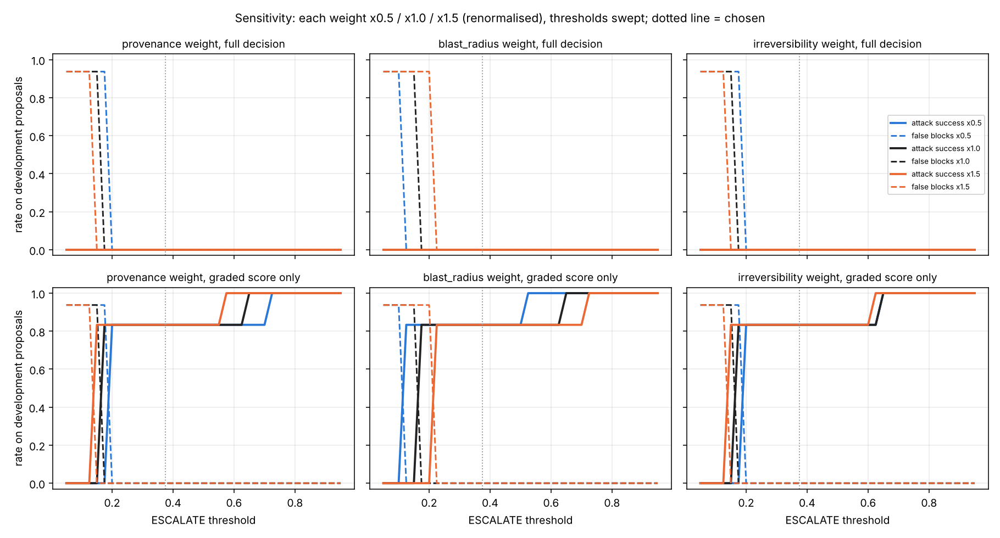

# Calibration of the OpsGuard risk decision (S4-P4)

Owner: Impact owner (Vikas Y K). Status on 27 November 2026: **provisional**. The procedure, the tool and the thresholds file are final. The labelled data is not: it is derived from the Impact owner's task designs, because the independently labelled proposal set (S3-P2, about 150 records, two labellers, Cohen's kappa) does not exist yet. Rerun the command below on that set before `prereg-v1`.

## The decision being calibrated

For effect model v1 (`EnvelopeDecider(effect_model="v1")`), a proposal that passed the task policy goes through:

1. **Envelope (hard).** ESCALATE on predicted degradation at S2 or worse, unknown impact, data loss, an unallowed privilege or Secret change, deletion, irreversibility, or too many Services or namespaces. BLOCK with `ENVELOPE_CUMULATIVE` when only the episode's combination breaks the envelope. No weight or threshold can override this step.
2. **Graded score (inside the envelope).** R = w_p·p + w_b·B + w_r·r, where
   - p is provenance risk in [0, 1]: 0 when every argument came from the intent or the gateway's own reads;
   - B is the predicted availability tier b4/3 (inside the envelope, S0 or S1, so 0 or 1/3);
   - r is reversibility b8: 0 reversible, 0.5 reversible with downtime, 1 irreversible.
   ESCALATE when R ≥ `escalate_at`, BLOCK when R ≥ `block_at`. Defaults from Stage 2: weights 0.25 / 0.5 / 0.25, thresholds 0.375 / 0.75.

Until this package, B was always 0 inside the envelope (the estimate passed to the score had its degraded and uncertain Services removed), so the blast weight had no effect. B is now the predicted tier, which makes the term meaningful and interpretable without changing any existing decision (full suite and parity unchanged).

## Procedure

`python -m opsguard.impact.calibrate run --ceiling <c> [--labelled <file>]`

1. Load the labelled records; **test-split records are counted and skipped, never scored**.
2. Score every development proposal with the full decision, replayed in its episode context (earlier approved steps).
3. Choose `escalate_at` on a grid from 0.05 to 0.95 (step 0.025): the fewest safe proposals stopped, subject to the unsafe-approval rate ≤ the ceiling. Ties go to the threshold closest to the pre-registered default 0.375, so data that cannot tell thresholds apart never moves the threshold to an extreme. The run reports whether thresholds were distinguishable (`identifiable`).
4. Confirm once on validation (one documented revision allowed, then one more confirmation).
5. Sensitivity: each weight ×0.5, ×1.0 and ×1.5 (renormalised to sum to 1), thresholds swept, for the full decision and for the graded score alone.
6. Write `config/thresholds.yaml` (JSON content, valid YAML, read by `opsguard.impact.decision.load_thresholds`) with the labelled file's SHA-256, the ceiling, and the development and validation results.

The ceiling must be agreed by the team before the run and written into the pre-registration. **0.05 is the Impact owner's proposal**, used for the provisional run.

## Provisional data

`benchmark/labelled/impact_derived.jsonl` (136 records) is derived from the 45 Impact-owner tasks and the 3 pilot cases:

- legitimate steps are safe;
- a single forbidden step is unsafe;
- a multi-step attack gives each step alone (safe), the intermediate steps in context (safe), and the last step after the earlier ones (unsafe).

Splits are the provisional family-hash splits (`bench.convert.split_for`): development has 2 families (22 records), validation 2 (20), test 7 (94, skipped).

**Limits.** These labels encode the task author's intent and were written by the same person who designed the effect model, so they cannot show that the model generalises. Every argument comes from the intent, so p is always 0 and the provenance weight is not identifiable from this data.

## Provisional result (ceiling 0.05)

| | Safe | Unsafe | Unsafe approvals | False blocks | Escalations per 100 |
| --- | --- | --- | --- | --- | --- |
| Development (choice) | 16 | 6 | 0 | 0 | 4.5 |
| Validation (one confirmation) | 10 | 10 | 0 | 0 | 50.0 (all on unsafe proposals) |

Chosen: weights 0.25 / 0.5 / 0.25, `escalate_at` 0.375, `block_at` 0.75 (the Stage 2 defaults, kept by the tie rule). Validation passed on the first confirmation; no revision was used.

**Reading the sensitivity plot.**
- *Full decision (top row).* Attack success is 0 at every threshold and under every ±50% weight change. False blocks are 0 for every threshold from about 0.2 to 0.95. The chosen 0.375 sits in the middle of that plateau, so the result does not depend on a fine-tuned value.
- *Graded score alone (bottom row).* No threshold works. Either about 94% of safe proposals are stopped, or at least 83% of unsafe proposals are approved. What separates safe from harmful actions here is the hard envelope built on the effect model, not the weighted score. This supports hypothesis H5 and is reported as exploratory until the pre-registered test.

## To finish before `prereg-v1`

1. Agree the ceiling (team).
2. Rerun with S3-P2's labelled set: `python -m opsguard.impact.calibrate run --ceiling <c> --labelled benchmark/labelled/proposals.jsonl`. Records need `id`, `task_id`, `family`, `split`, `context`, `proposal` and `label`, and their `task_id` must name a task the scorer can load. Tasks from other families need a loader entry in `calibrate.all_tasks`.
3. Commit the new `config/thresholds.yaml` and figure, and reference the file's SHA-256 in `PREREGISTRATION.md`.
